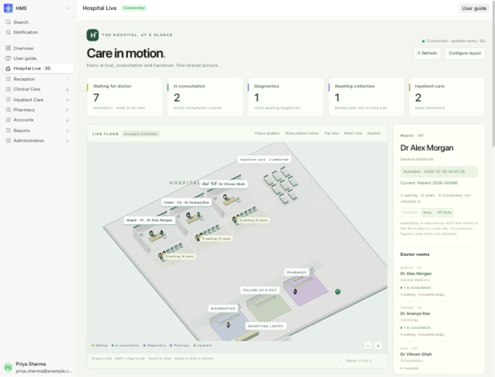

# Watch hospital activity in 3D

See action-driven patient characters, doctor rooms, waiting seats and current care activity.

**Who can do this:** Receptionist · Doctor · Pharmacist · System Manager

[All workflows](README.md)

## What this workflow does

Hospital Live is a grouped 3D schematic of saved HMS activity. Every character represents an allowed HMS record. The page reads saved states; it does not advance clinical care, track physical positions or change patient records when you move the camera.

## Before you start

- An HMS staff role; active practitioners and saved visits for a populated view. A WebGL 2 browser enables the 3D scene; the activity list works when 3D is unavailable.

## 1. Open Hospital Live

Choose Hospital Live · 3D near the top of the HMS sidebar. Counts cover only records available to your role. The page refreshes every 15 seconds while visible; Refresh checks immediately, and Pause updates freezes further polling.

## 2. Configure rooms and waiting seats

A System Manager chooses Configure layout and opens Hospital Settings → Hospital Live · 3D layout. Add one enabled row per active doctor, give each room a different name, and choose 1–24 waiting seats. Row order sets the schematic layout. Without configured rows, each allowed active practitioner receives a consultation room with eight seats. Six rooms appear per floor view; the arrows open the next group.

## 3. Read characters from HMS actions

A Scheduled appointment has no seated patient. Check In creates a waiting character in that doctor’s queue. Under Consultation moves that patient into the doctor’s room. Lab/Diagnostics Pending places the patient in diagnostics; Lab/Diagnostics Completed returns the visit to the doctor’s waiting area. Prescription Given places the patient at the next-step area, or pharmacy when a posted sale remains uncollected. Completed, Closed Early and Cancelled / No Show remove the visit from the active floor.

## 4. Separate old open work and other care areas

Earlier outpatient visits that remain open are listed under Earlier open visits, excluded from today’s waiting seats. Inpatient admissions stay active until discharged. Tracked posted pharmacy sales show outstanding handovers; posting/return/collection actions update that queue. An admission takes precedence over an OP avatar for the same patient, and an active consultation takes precedence over another waiting visit.

## 5. Report doctor availability

Select a room. The linked Doctor can report their own Available, Away or Off Duty status; a System Manager can report any active doctor. Availability is dated and resets to Not Recorded on a new day. A doctor character is drawn for a recorded active consultation or today’s Available report. An appointment alone never proves the doctor is present.

## 6. Inspect and navigate

Select a room label, character or activity row to inspect its recorded state. Open HMS record takes you to the underlying form, where normal permissions and workflow rules apply. Drag to orbit, Shift + drag to pan, scroll or use +/− to zoom, and use Top view or Reset view. Expand gives the map more space.

## 7. Review exceptions and privacy

Patient names are hidden by default; Show patient names reveals only labels available to your role. Review multiple active consultations, seat overflow, earlier open visits, missing room mappings, stale connections and truncation notices. The 3D view shows at most 160 patient characters and 24 beds; the activity list and original HMS forms retain additional permitted records.

## What success looks like

The scene changes after a saved HMS action, room waiting counts match today’s active visit records, and selected activity opens the correct underlying HMS record.

## Common problems and recovery

Positions, chairs and walking paths are schematic, not real-time location sensing. Multiple changes between 15-second snapshots may appear as one transition. Reduced-motion preferences disable walking animation. A connection failure clearly leaves the last snapshot stale; it does not continue inventing activity. Results are limited to 1,000 per record type and the activity list shows 200 rows at a time; use original HMS lists for larger data sets.

## Screenshots and walkthrough

The overview shows the implemented page on 29 October 2026. Continuous screen-recorded GIF coverage remains pending.

Hospital Live: doctor rooms, grouped waiting seats, active care areas and recorded patient activity. Select a room to inspect its current HMS records.

## Related workflows

- [Check in a booked or walk-in patient](check-in.md)
- [Record a consultation and corrections](consultation.md)
- [Request, receive and review a lab report](labs.md)
- [Dispense, hand over and return medicines](dispense.md)
- [Admit, allocate a bed and transfer](admission.md)

Written instructions source reviewed 29 October 2026. Model and API tests cover action mapping, permissions, configuration, attendance and older-visit handling. Full user-guide role/media verification remains separate.

Examples follow Maya Patel, Dr Alex Morgan and Paracetamol 500 mg through the HMS workflows. Contact addresses use example domains; the reminder demonstration does not send email.
